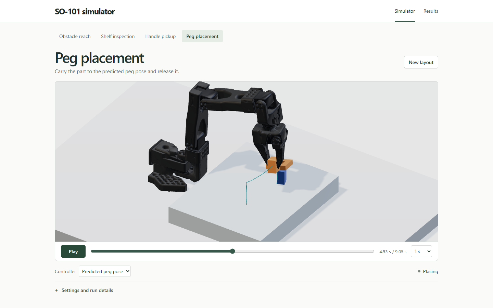

# SO-101 path learning

Four MuJoCo tasks use labeled simulator data. For obstacle reach and shelf inspection, a trained neural network scores candidate paths. For handle pickup and peg placement, ridge regressors estimate planar poses from clean overhead segmentation masks.



[Interactive article](https://dunlichan.com/writings/so101-path-learning/) · [Run the article locally](article/README.md) · [Shelf study](SHELF_STUDY.md) · [Obstacle reach results](RESULTS.md)

## Open the studio

On Windows with Python 3.13 installed, double-click **Start SO-101.cmd**. The launcher creates a virtual environment and installs the simulator dependencies on first use. The viewer and released models run on a CPU. Drag to orbit, scroll to zoom, or drag the timeline to inspect an individual pose. **New layout** samples another scene. **Apply layout** reruns the controllers after a change. Planned paths can be enabled for the reach and shelf tasks.

On Linux or macOS, from the project root:

```bash
python3 -m venv .venv
.venv/bin/python -m pip install -r requirements.txt
OPENBLAS_NUM_THREADS=1 .venv/bin/python studio.py --open
```

The default URL is http://127.0.0.1:8766/. The browser uses WebGL 2 and the included Three.js modules and geometry. Each task has a standalone recorded comparison.

## Supervised grasp and placement

Run `python visual_study.py` from this directory to generate 1,024 training and 256 validation layouts, fit the two regressors on CPU and evaluate 32 independent physical layouts. The synthetic overhead masks are rasterized from the known geometry. Each estimator receives the centroid and normalized shape moments from its own mask and predicts (x, y, yaw). Inverse kinematics and jaw timing execute the predicted grasp and placement.

| Task | Fixed pose | Predicted pose | Predicted XY error |
| --- | ---: | ---: | ---: |
| Hold a 35 mm lift for 0.5 s | 24/32 | 32/32 | 0.15 mm |
| Release and seat on a peg for 0.5 s | 2/32 | 32/32 | 0.22 mm |

Both placement controllers use the same predicted pickup. Fixed poses are training-set means. The primary test uses 96 × 96 masks and 2 mm side clearance. Halving the resolution raised mean XY errors to 0.50 and 0.61 mm. These experiments assume a level part, a fixed overhead projection and clean object masks.

[Training and evaluation](visual_study.py) · [Mask generation and inference](visual_pose.py) · [Weights and paired trials](experiments/visual-pose/) · [Pickup film](web/pickup.mp4) · [Placement film](web/placement.mp4)

## Single-fixture model

We trained on 4,096 procedurally generated scenes. The training labels come from checking the official SO-101 model for contact along each candidate trajectory. The selected neural network estimates collision risk for each path. Inference combines that risk with additional joint travel to rank the candidates. The UI selects the path before running the servo simulator. A direct baseline interpolates between the same two joint poses.

The learned model reached **87/96** targets in held-out servo replays. Direct interpolation reached **18/96**. These tasks cover one known box-shaped fixture, a known scene state, reachable joint-pose targets and one training seed. The arm has six actuators. The benchmark keeps the gripper opening fixed throughout each reach and provides wrist-roll endpoint poses. The results measure simulated reaching.

## Single-fixture dataset, training and experiment loop

`prepare.py` creates the fixed train, validation and test splits using MuJoCo 3.3.7. The release includes the resulting data, training source snapshots and all six models. The official autoresearch repository is installed as a separate checkout on the development machine and the A100. Its upstream GPU environment is separate from the arm training environment. Cloning the project elsewhere requires fetching that checkout to inspect or run the original language-model workload.

```bash
git clone https://github.com/karpathy/autoresearch.git tools/autoresearch
git -C tools/autoresearch checkout 228791fb499afffb54b46200aca536f79142f117
```

For the arm experiments, use a CUDA-capable PyTorch install. The qualified A100 runtime used Python 3.10, PyTorch 2.7.0 and MuJoCo 3.3.7. With that PyTorch available in the arm environment, run the following from the project directory.

```bash
.venv/bin/python check_contacts.py
OPENBLAS_NUM_THREADS=1 .venv/bin/python train.py new-trial --recipe shared --width 96 --depth 2
```

Follow [the arm-specific experiment brief](program.md) to propose and test code changes. The trainer writes to a fresh trial folder and appends a keep/discard decision. The fixed work budget is 1,000 optimizer updates per trial. Training, evaluation, and web serving can be run independently. The complete release already contains the fixed dataset and frozen final scores. Generating new data with `python prepare.py --workers 8` replaces the generated data files in that checkout.

## Model and viewer assets

The SO-101 follower MJCF and 13 STL files are from TheRobotStudio at commit `141aea7bcac2744d92998e30268c413202a56f96`. Their Apache 2.0 license is in [assets/so101/LICENSE](assets/so101/LICENSE). MuJoCo uses the original mesh files. `export_mesh.py` clusters visual vertices at 0.60 mm for faster browser rendering. The viewer vendors Three.js r180 under its [MIT license](web/vendor/LICENSE). [SO-101 simulation source](https://github.com/TheRobotStudio/SO-ARM100/tree/141aea7bcac2744d92998e30268c413202a56f96/Simulation/SO101) · [Karpathy autoresearch](https://github.com/karpathy/autoresearch)

The desktop UI checks use Python Playwright and Chromium. With the studio running, `python check_studio.py` exercises playback, both planners, target and fixture edits, scene generation and mobile layout. The shelf tests also exercise the cutaway, camera, surface readout, curated comparisons and adjustable opening. `python record_demo.py` renders the comparison using MuJoCo, Pillow and ffmpeg. Run `python record_shelf.py` to render the shelf film with those same dependencies.
